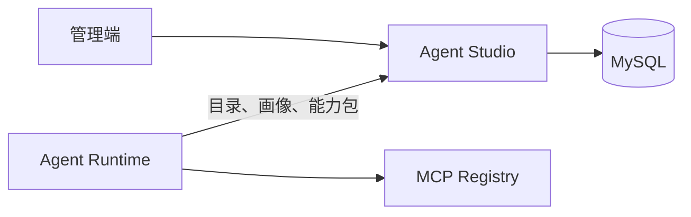

<p align="center">
  
</p>

# g2rain-agent-studio

[](LICENSE)
[](https://openjdk.org/)
[](https://spring.io/projects/spring-boot)
[](https://spring.io/projects/spring-cloud)
[](https://maven.apache.org/)

G2rain（谷雨）是面向企业的开源智能体平台，连接模型、知识与业务工具，以 SaaS 基座和应用开发工具链支撑智能应用落地。智能体平台已开源，具体组件、版本与接入方式以各责任仓库的说明为准。`g2rain-agent-studio` 是其中的 Agent 配置与运行资料服务：维护 Agent 画像、Skill 定义及其执行契约、Agent-Skill 绑定和 Skill-Tool 绑定，并向 Runtime 提供可装载的能力包；它不代表或替代整个平台能力。

[官网](https://www.g2rain.com) · [完整文档](docs/index.md) · [中央架构 Profile](https://github.com/g2rain/g2rain/tree/architecture-v1.0.0/docs/architecture/profiles/java-domain-service) · [架构说明](docs/architecture/overview.md) · [本地开发](docs/development/local-development.md) · [Issues](https://github.com/g2rain/g2rain/issues) · [Discussions](https://github.com/g2rain/g2rain/discussions)

## 项目定位

`g2rain-agent-studio` 位于 Agent 平台的配置资料层，是 Agent、Skill 与工具绑定关系的权威数据服务：

- 向 Agent Runtime 提供活动 Agent 目录、画像、Skill 摘要和完整能力包。
- 向管理端提供 Agent、Skill 及绑定关系的维护入口。
- 使用 MySQL 持久化配置资料，并通过 Redis、Nacos 接入平台基础设施。
- 不执行对话或任务、不注册 MCP 服务和工具、不管理模型供应商，也不提供 Gateway/IAM 身份链路或平台部署编排。

## 核心领域

| 能力 | 说明 |
| --- | --- |
| Agent 画像管理 | 维护身份、使命、边界、风格、原则及启停状态。 |
| Skill 管理 | 维护 Skill 的语义描述、操作手册和执行契约。 |
| 能力绑定 | 管理 Agent-Skill 与 Skill-Tool 绑定，限定 Agent 可使用的能力。 |
| Runtime 装载 | 提供活动 Agent 目录、指定画像、Skill 短目录与完整能力包。 |

## 运行协作



1. 管理端创建或维护 Agent、Skill 及其绑定关系。
2. Runtime 查询活动 Agent 目录，并按需解析指定画像或 Skill 摘要。
3. Runtime 请求能力包；Studio 仅返回启用绑定的活动 Skill，并为每个 Skill 组装已启用的工具名称。

## 架构概览

```text
g2rain-agent-studio-api
  查询、目录、画像、Skill 摘要及能力包契约
          ↑
g2rain-agent-studio-biz
  配置领域、Controller、Service、DAO 与转换逻辑
          ↑
g2rain-agent-studio-startup
  Spring Boot 启动、运行配置与 Jib 镜像构建
```

依赖只能沿 `startup → biz → api` 方向流动；详细约束见[依赖边界](docs/architecture/dependencies.md)。

| 模块 | 说明 |
| --- | --- |
| `g2rain-agent-studio-api` | 发布查询、目录、画像、Skill 摘要及能力包契约。 |
| `g2rain-agent-studio-biz` | 实现配置领域、Controller、Service、DAO 与转换逻辑。 |
| `g2rain-agent-studio-startup` | 组装 Spring Boot、虚拟线程、参数解析和环境配置。 |

## 技术栈

| 类别 | 技术 |
| --- | --- |
| 运行时 | Java 25、Spring Boot 4.1.2、Spring Cloud 2025.1.4 |
| 数据访问 | MyBatis、MySQL、MapStruct |
| 平台基础设施 | Redis、Nacos |
| API 与文档 | Spring Web、Jakarta Validation、OpenAPI |
| 构建与镜像 | Maven、Jib、Docker daemon（本地镜像目标） |
| 测试 | Spring Boot Test；具体覆盖范围见[测试策略](docs/development/testing.md) |

## 快速开始

### 环境

- JDK 25
- Maven 3.9+
- MySQL 8.0.13+
- Redis
- Nacos

默认 profile 为 `nacos`；本地联调可选择 `dev`，并在本机安全地补全环境配置。

### 构建与测试

```bash
mvn clean verify
```

### 启动服务

```powershell
mvn -pl g2rain-agent-studio-startup -am spring-boot:run "-Dspring-boot.run.profiles=dev"
```

端口由 `SERVER_PORT` 环境变量决定；未设置时使用 `8080`。部署到共享环境时，推荐由 Nacos 管理数据源和服务发现配置，凭据仅通过安全的环境配置注入。

健康检查入口：

```text
GET /actuator/health
```

## 接口说明

| 接口 | 用途 |
| --- | --- |
| `GET /agent_profile/active_catalog` | 获取活动 Agent 目录；合并平台级与当前租户的自定义画像。 |
| `GET /agent_profile/{agentId}/resolve` | 按 ID 解析 Agent 画像及状态。 |
| `GET /agent_profile/{agentId}/skill_digest` | 获取启用且活动的 Skill 短目录，不包含手册、契约与工具。 |
| `GET /agent_profile/{agentId}/capability_bundle` | 获取完整能力包：Skill 手册、执行契约及已绑定工具。 |
| `/agent_profile`、`/skill_profile`、`/agent_skill_binding`、`/skill_tool_binding` | 管理端的查询、保存与删除入口。 |

## GHCR 镜像

- 镜像地址：`ghcr.io/g2rain/g2rain-agent-studio`。
- 稳定版使用 `1.0.0` 这类版本标签，并同时发布 `sha-<完整提交 SHA>` 可追溯标签；不会更新 `latest`。
- 包公开后可拉取：`docker pull ghcr.io/g2rain/g2rain-agent-studio:1.0.0`。
- 仅推送精确格式的 `v<major>.<minor>.<patch>` Git tag 才会发布；tag 提交必须在 `main` 历史中，并含同名发布说明。

完整的 GHCR 权限、首次公开、发布顺序、镜像内容、配置与部署说明见[构建、镜像与部署](docs/operations/deployment.md)。GitHub Actions 的容器构建和推送不代表在线演示或实际部署已经验证。

## 职责边界

- Agent Runtime 在任务执行时读取由 Studio 管理的 Agent 配置与技能资料。
- MCP Registry 管理 Agent 可使用的外部工具能力。
- Model Nexus 为 Agent 工作流提供统一模型访问入口。
- Gateway 与 IAM 负责平台入口、身份链路及其授权策略；管理端访问 Studio 应通过该链路。

## 安全边界

- `organ_id` 必须来自可信上下文，查询、写入和能力包返回需保持租户一致。
- 保存、删除、启停和绑定调整需要细粒度授权与审计。
- Skill 手册、执行契约、Agent 边界与工具绑定可能含敏感业务资料，日志、响应和文档遵循最小化原则。
- 不在仓库或配置中提交密码、Token、密钥和真实环境地址。

## 项目文档

| 场景 | 入口 |
| --- | --- |
| 文档首页 | [docs/index.md](docs/index.md) |
| 架构与模块 | [架构总览](docs/architecture/overview.md) · [模块说明](docs/architecture/modules.md) · [依赖边界](docs/architecture/dependencies.md) |
| 本地开发与测试 | [本地开发](docs/development/local-development.md) · [测试策略](docs/development/testing.md) |
| API 与数据 | [API 与数据库](docs/development/api-database.md) |
| 配置与部署 | [配置](docs/operations/configuration.md) · [构建、镜像与部署](docs/operations/deployment.md) |
| 安全与排障 | [安全边界](docs/security/security-boundaries.md) · [排障](docs/operations/troubleshooting.md) |
| 发布记录 | [v1.0.0 GHCR 首次发布](docs/releases/v1.0.0.md) |

## 贡献

欢迎通过 Issue、文档改进、功能建议和 Pull Request 参与贡献。提交前请补充必要的测试与文档，执行 `mvn clean verify`，并同步 API、SQL、配置、安全和架构说明。

## 许可证

本项目声明采用 [Apache 2.0 许可证](LICENSE)；发布前应先将仓库中的许可证正文替换为 Apache 官方完整英文文本，以使该声明、Maven 元数据和 OCI `Apache-2.0` 标签一致。
